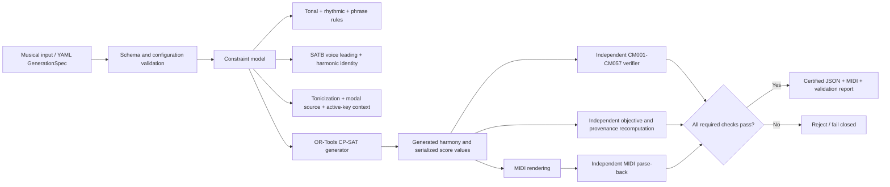

# Constraint Music

**Deterministic symbolic SATB generation with explicit musical constraints, CP-SAT search, and independent post-solve verification.**

Constraint Music turns a declarative musical specification into a verifiable symbolic-music artifact. A YAML `GenerationSpec` is validated and compiled into an OR-Tools CP-SAT model; the generator produces melody, rhythm, bass, harmonic identity, and SATB voicing; a separate application-level verifier reconstructs the declared musical semantics from ordinary serialized values before JSON and MIDI outputs are accepted.

Current package: **2.13.0a1**  
Artifact schema / executable contract: **2.13 / 2.13**  
Python: **3.11–3.13**

> A solver status of `OPTIMAL` or `FEASIBLE` is not certification. Solver/verifier, objective, request-binding, artifact-shape, or delivered-MIDI disagreement fails closed.

## Architecture



The generator and verifier intentionally sit on opposite sides of the trust boundary. The verifier does not accept an opaque chord label or solver witness as truth; it reconstructs the relevant musical identity from the serialized result and the declared contract.

See [Architecture](docs/ARCHITECTURE.md), [Verification](docs/VERIFICATION.md), [Executable Contract](docs/EXECUTABLE_CONTRACT.md), and [Assurance Boundary](docs/ASSURANCE_BOUNDARY.md).

## Core capabilities

Constraint Music currently includes:

- deterministic, seedable CP-SAT generation;
- explicit pitch, rhythm, motif, phrase, cadence, and progression constraints;
- solver-native SATB voicing with range, ordering, spacing, completeness, doubling, parallel-perfect, and tendency-tone rules;
- triads and opt-in seventh-chord vocabulary with structured inversion semantics;
- verified applied-dominant tonicization;
- verified modal mixture and a scoped borrowed-seventh family;
- persistent active-key context for one certified same-mode modulation to the dominant;
- target-derived secondary leading-tone triads;
- fully diminished and eligible half-diminished secondary leading-tone sevenths, including all four inversions where certified;
- exact no-good enumeration and bounded Pareto candidate search;
- independent objective-vector recomputation;
- fail-closed JSON artifact validation, request binding, provenance digests, and exact SATB MIDI delivery checking;
- a solver-optional checker/certifier path;
- an opt-in request-bound SATB harmonization API with independent score and native-MIDI checks.

The harmonic representation remains decomposed rather than relying on one trusted Roman-numeral field. Important axes include functional/support degree, harmonic form, inversion, nullable local target, nullable modal source, persistent key context, and SATB voicing.

## Musical semantics

The current executable contract exposes **57 stable hard-rule IDs** (`CM001`–`CM057`). The major harmonic extensions are documented separately so their scope and interactions remain explicit:

- [SATB harmony](docs/SATB_HARMONY.md)
- [Expanded harmony](docs/EXPANDED_HARMONY.md)
- [Applied-dominant tonicization](docs/TONICIZATION.md)
- [Modal mixture](docs/MODAL_MIXTURE.md)
- [Borrowed seventh chords](docs/BORROWED_SEVENTHS.md)
- [Secondary leading-tone triads](docs/SECONDARY_LEADING_TONE.md)
- [Secondary leading-tone sevenths](docs/SECONDARY_LEADING_TONE_SEVENTHS.md)
- [Phrase grammar](docs/PHRASE_GRAMMAR.md)
- [Rhythm and motifs](docs/RHYTHM_AND_MOTIFS.md)

## Install

From a checkout, create a Python 3.11+ environment and install the capability you need:

```bash
python -m venv .venv
# Linux/macOS
source .venv/bin/activate
# Windows PowerShell: .venv\Scripts\Activate.ps1

# Checker/certifier only; OR-Tools is not required
python -m pip install -e .

# Generation + checking
python -m pip install -e ".[generation]"

# Contributor/research environment with exact research pins
python -m pip install -e ".[dev]"
```

## Generate

```bash
constraint-music generate examples/secondary_leading_tone_sevenths.yaml \
  --output build/composition.mid \
  --json build/composition.json \
  --print-grid
```

The default `certified-satb` profile writes conductor plus exact S/A/T/B tracks. Use `--render-profile melody-plus-satb` when the separately specified rhythmic melody projection is also required.

## Verify and certify

Inspect an artifact without rerunning CP-SAT:

```bash
constraint-music verify build/composition.json
```

Run the strict request-and-delivery gate:

```bash
constraint-music certify build/composition.json \
  --spec examples/secondary_leading_tone_sevenths.yaml \
  --midi build/composition.mid \
  --certificate build/composition.certificate.json
```

`verify` checks embedded-context consistency. `certify` validates artifact shape, binds an independently supplied request and contract, recomputes semantic and claim digests, and independently parses the delivered MIDI. `--allow-legacy` only inspects supported 2.12 artifacts; it does not bypass integrity failures.

The separate request-bound harmonization API is described in [Request-Bound Harmonization](docs/REQUEST_BOUND_HARMONIZATION.md).

## Testing and release assurance

Install the development extra, then run the normal quality suite:

```bash
ruff check src tests research
mypy src
pytest --cov=constraint_music --cov-report=term-missing
python -m build
```

The repository-authored aggregate gate is:

```bash
python -m research.validate_release_assurance
```

That gate validates the pinned research environment, lint/types/tests/builds, solver-free checker installation, deterministic evidence replays, evidence SHA-256 values, frozen bounded-assurance claim state, and the exact clean Git commit/tree under review. CI runs the quality gate on Python 3.11, 3.12, and 3.13 and separately replays preserved cross-system research histories.

See [Reproducibility](docs/REPRODUCIBILITY.md) and [Engineering Assurance Status](docs/ENGINEERING_ASSURANCE_STATUS.md).

## Research evidence

Research material is intentionally kept under [`research/`](research/README.md) rather than mixed into the product narrative. Frozen protocols, source/receipt histories, raw outputs, derived reports, negative findings, and prior study versions are retained for reproducibility.

The current request-bound paired study reports **128/128** reproducible native/adapted passes for the new API on its declared grammar and configurations, versus legacy Constraint Music **53/128**, music21 **111/128**, and adapted Diatony **38/128**. Against music21 there are 17 Constraint-Music-only passes and no losses; the corrected exact paired p-value is **0.0000458**, with a conservative simultaneous completion-difference interval of **[+2.34, +23.01] percentage points**. The separately prespecified **+10-point minimum practical margin is not established against music21**.

Those results support a scoped completion difference on the declared grammar and configurations. They do **not** establish general musical quality, universal completeness, novelty of constraint-based harmony, or overall superiority to other music systems. Earlier v1/v2 studies and their negative findings remain preserved rather than rewritten.

See [Cross-System Study Status](docs/CROSS_SYSTEM_STUDY_STATUS.md), the [v3 report](research/paired_cross_system_v3/REPORT.md), and the [integrated manuscript draft](docs/CROSS_SYSTEM_CONFORMANCE_PAPER_DRAFT.md).

## Repository layout

```text
src/constraint_music/   Product implementation
examples/               Example generation specifications
tests/                  Correctness, adversarial, isolation, and regression tests
docs/                   Product, musical-semantics, assurance, and usage documentation
research/               Versioned experiments, protocols, evidence, replay tools, and reports
.github/workflows/       CI and reproducibility workflows
```

A documentation map is available in [`docs/README.md`](docs/README.md).

## Current limitations

- Independent verification is an application-level separation of trust, not a formal proof of OR-Tools, Python, the operating system, or the host machine.
- The certified modulation model is deliberately narrow: one same-mode modulation to the dominant under explicit pivot and cadence rules.
- Secondary-function, modal-mixture, and seventh-chord support is contract-scoped rather than unrestricted chromatic-harmony inference.
- The request-bound comparative studies use declared finite grammars and configured endpoints; they are not unconditioned rankings of music systems.
- Finite adversarial, bounded-conformance, and performance evidence does not imply population-level robustness or latency/capacity guarantees.
- Aesthetic quality and complete historical-style authenticity are outside the executable contract.

Future work that has not been implemented is separated from current capability in [Future Work](docs/FUTURE_WORK.md).

## License

Constraint Music is publicly visible but **proprietary**. See [`LICENSE`](LICENSE). The repository does not grant a general right to use, modify, redistribute, or execute the software beyond the rights stated in that license and applicable GitHub terms.