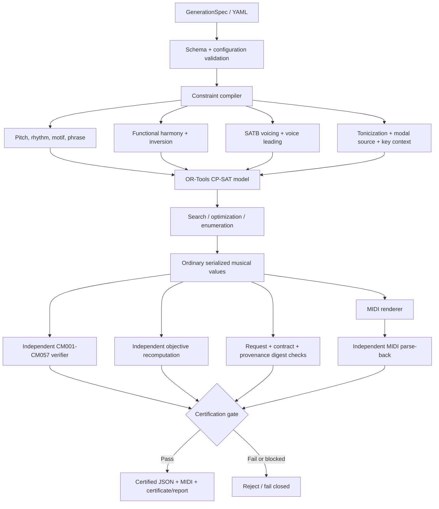

# Architecture

Constraint Music is a deterministic symbolic-music system built around a strict separation between **generation** and **independent certification**. The generator may search, optimize, and derive internal witnesses; the verifier must be able to reconstruct the declared contract from ordinary serialized values without trusting those internal witnesses.

Current package: `2.13.0a1`  
Artifact schema: `2.13`  
Executable contract: `2.13`  
Hard-rule range: `CM001-CM057`

## System pipeline

A feasible or optimal CP-SAT assignment is not equivalent to a certified composition. Export is accepted only when every required independent check succeeds.

## Trust boundary

The architecture deliberately separates two roles:

1. **Generator / proposer** — compiles musical constraints, searches the CP-SAT space, optimizes objectives, and may derive solver-native helper variables.
2. **Verifier / certifier** — reconstructs the declared musical semantics from the resulting artifact, checks the executable contract, recomputes objectives and provenance, and validates delivered MIDI independently.

The verifier does not accept a trusted serialized “function” or “quality” label for secondary harmony. Classification is re-derived from active key, target, support degree, harmonic form, inversion, modal-source state, and SATB pitch content.

## Semantic model

Constraint Music avoids a monolithic Roman-numeral state. Harmonic meaning is decomposed into orthogonal axes:

- functional/support degree;
- harmonic kind (`TRIAD` / `SEVENTH`);
- inversion;
- nullable local target identity;
- nullable modal-source identity;
- persistent active-key context;
- SATB realization.

This decomposition allows narrowly scoped harmonic extensions without replacing the established artifact model.

## Global key and persistent active key

The artifact-global key is immutable. A certified persistent modulation changes the **active local key** used to interpret later beats without rewriting the global key.

The current modulation contract supports one same-mode move to the dominant with:

- an explicit destination key and boundary;
- source I reinterpreted as destination IV at the pivot;
- persistent destination-key interpretation after the boundary;
- destination V-I confirmation;
- exact destination-leading-tone resolution.

The solver may use broader storage domains internally, but each musical use remains gated by the exact active-key context. The verifier independently enforces the same rule.

## Harmonic-family routing

### Diatonic triads and sevenths

The expanded-harmony layer supports diatonic triads and complete seventh chords with structured inversion semantics.

### Applied dominants

Applied dominants use explicit nullable target identity and are reconstructed as exact active-key `V7/x` sonorities with immediate target resolution and tendency-tone checks.

### Modal mixture and borrowed sevenths

Modal mixture carries an explicit parallel-source identity. Borrowed sevenths are restricted to a contract-defined subset compatible with the established outer-voice and progression semantics.

### Secondary leading-tone triads

`vii°/x` triads reuse target identity. Their chromatic root is not forged into a fake diatonic degree; a deterministic support degree preserves progression compatibility while target + voicing carry the actual function.

### Secondary leading-tone sevenths

The certified family includes fully diminished secondary leading-tone sevenths and eligible half-diminished variants for major local targets, with all four inversion figures where the contract permits them.

Classification is reconstructed from exact target-derived pitch content, support degree, inversion, active key, and resolution behavior. This keeps solver witnesses out of the artifact trust boundary.

## Scoped outer-voice expansion

A genuine third-inversion secondary leading-tone seventh places the chordal seventh in the bass and may require chromatic outer-voice pitches. Constraint Music therefore uses a scoped exception rather than weakening the global SATB contract:

- expanded outer-voice storage is enabled only on the secondary-leading-tone-seventh path;
- ordinary beats retain the established diatonic/support interpretation;
- chromatic strong soprano or bass values are permitted only after exact reconstruction of the certified secondary-seventh identity;
- inversion `3` cannot leak onto unrelated chords.

## Independent tendency checks

The compiler and verifier enforce the same target-/quality-dependent resolution deltas, but through separate code paths. The current secondary-leading-tone-seventh rules include:

- local leading tone/root: `+1` semitone;
- diminished fifth: `-1` for a major target, `-2` for a minor target;
- fully diminished chordal seventh: `-1` semitone;
- half-diminished chordal seventh: `-2` semitones.

The rule is voice-agnostic and therefore also applies to the bass in a genuine `42` inversion.

## Search, optimization, and validity

Search policy does not define musical validity. Weighted solve, no-good enumeration, and Pareto candidate search are proposal mechanisms only. The hard-rule contract is checked independently after solving.

Distinctness axes remain explicit and orthogonal: melody, rhythm, bass, harmony, voicing, harmonic form, tonicization target, modal source, and key context.

## Artifact and delivery assurance

Schema/contract 2.13 adds fail-closed artifact shape, explicit rule outcomes, request binding, semantic/claim digests, and strict delivery validation. The checker/certifier can be installed without OR-Tools so verification is not operationally coupled to the generator dependency.

The strict certification route verifies:

- current artifact shape before semantic reconstruction;
- an independently supplied request/specification;
- executable-rule outcomes and applicability;
- objective/provenance integrity;
- generated MIDI through an independent parse-back path.

See [Verification](VERIFICATION.md), [Executable Contract](EXECUTABLE_CONTRACT.md), [Assurance Boundary](ASSURANCE_BOUNDARY.md), and [Engineering Assurance Status](ENGINEERING_ASSURANCE_STATUS.md).

## Research boundary

Research experiments, frozen protocols, comparator adapters, raw evidence, and replay tooling live under [`../research/`](../research/README.md). Historical study identifiers are retained there when required for reproducibility. Product documentation describes the current architecture rather than the order in which it was implemented.

## Scope limits

The architecture does not claim formal proof of OR-Tools, Python, or the host machine. Current certified harmonic scope also excludes arbitrary modulation chains, distant/enharmonic modulation, unrestricted chromatic-function inference, broad augmented-sixth/Neapolitan reinterpretation, free key-center inference, and probabilistic harmony certification.
