# Constraint Music — Architecture Overview

This diagram presents the current Constraint Music trust architecture from declarative musical intent through CP-SAT search, independent certification, and final delivery.

```mermaid
flowchart LR
    subgraph INPUT["1 · MUSICAL SPECIFICATION"]
        direction TB
        SPEC["YAML GenerationSpec<br/>key · rhythm · phrase · harmony · seed"]
        REQUEST["External certification request<br/>specification + expected delivery"]
    end

    subgraph COMPILE["2 · SYMBOLIC COMPILATION"]
        direction TB
        VALIDATE["Schema + configuration validation"]
        TONAL["Tonal · rhythm · phrase constraints"]
        SATB["SATB voice-leading<br/>range · spacing · doubling · parallels"]
        CONTEXT["Harmonic context<br/>tonicization · modal source · active key"]
        CONTRACT["Executable contract<br/>CM001–CM057"]
    end

    subgraph SEARCH["3 · CONSTRAINT SEARCH"]
        direction TB
        CPSAT["OR-Tools CP-SAT"]
        CANDIDATE["Candidate assignment<br/>melody · bass · harmony · S/A/T/B"]
    end

    subgraph ARTIFACT["4 · ARTIFACT BOUNDARY"]
        direction TB
        JSON["Serialized JSON artifact<br/>score values + provenance digests"]
        MIDI["MIDI renderer<br/>certified-satb / melody-plus-satb"]
    end

    subgraph VERIFY["5 · INDEPENDENT CERTIFICATION"]
        direction TB
        SHAPE["Artifact shape + schema checks"]
        BIND["Independent request binding"]
        SEMANTICS["Semantic reconstruction<br/>from ordinary serialized values"]
        OBJECTIVE["Objective + provenance recomputation"]
        PARSE["Independent MIDI parse-back<br/>pitch · time · voice · event count"]
        GATE{"Every required check passes?"}
    end

    subgraph DELIVERY["6 · DELIVERY"]
        direction TB
        CERT["Validation certificate"]
        RELEASE["Certified JSON + MIDI"]
        REJECT["Reject / fail closed"]
    end

    SPEC --> VALIDATE
    VALIDATE --> TONAL
    VALIDATE --> SATB
    VALIDATE --> CONTEXT

    TONAL --> CPSAT
    SATB --> CPSAT
    CONTEXT --> CPSAT
    CPSAT --> CANDIDATE

    CANDIDATE --> JSON
    CANDIDATE --> MIDI

    REQUEST --> BIND
    JSON --> SHAPE
    JSON --> BIND
    JSON --> SEMANTICS
    JSON --> OBJECTIVE
    MIDI --> PARSE
    CONTRACT -. "independent rule definitions" .-> SEMANTICS

    SHAPE --> GATE
    BIND --> GATE
    SEMANTICS --> GATE
    OBJECTIVE --> GATE
    PARSE --> GATE

    GATE -->|YES| CERT
    CERT --> RELEASE
    GATE -->|NO| REJECT

    classDef input fill:#eef2ff,stroke:#4f46e5,stroke-width:2px,color:#111827;
    classDef compile fill:#ecfeff,stroke:#0891b2,stroke-width:2px,color:#111827;
    classDef search fill:#f0fdf4,stroke:#16a34a,stroke-width:2px,color:#111827;
    classDef artifact fill:#fff7ed,stroke:#ea580c,stroke-width:2px,color:#111827;
    classDef verify fill:#faf5ff,stroke:#9333ea,stroke-width:2px,color:#111827;
    classDef success fill:#ecfdf5,stroke:#059669,stroke-width:3px,color:#064e3b;
    classDef failure fill:#fef2f2,stroke:#dc2626,stroke-width:3px,color:#7f1d1d;
    classDef gate fill:#ffffff,stroke:#7c3aed,stroke-width:3px,color:#111827;

    class SPEC,REQUEST input;
    class VALIDATE,TONAL,SATB,CONTEXT,CONTRACT compile;
    class CPSAT,CANDIDATE search;
    class JSON,MIDI artifact;
    class SHAPE,BIND,SEMANTICS,OBJECTIVE,PARSE verify;
    class GATE gate;
    class CERT,RELEASE success;
    class REJECT failure;
```

## Trust boundary

The central design rule is deliberately asymmetric:

**the generator may propose a candidate, but only the independent certification path may authorize delivery.**

A CP-SAT result of `FEASIBLE` or `OPTIMAL` is therefore not a certificate. The checker independently reconstructs musical semantics from serialized score values, binds the artifact to the supplied request, recomputes claims and digests, and parses the delivered MIDI rather than trusting the renderer's internal state.

This separation is what allows Constraint Music to fail closed when the solver, serialized artifact, request, objective metadata, verifier, or delivered MIDI disagree.

For implementation details, see [Architecture](ARCHITECTURE.md), [Verification](VERIFICATION.md), [Executable Contract](EXECUTABLE_CONTRACT.md), and [Assurance Boundary](ASSURANCE_BOUNDARY.md).
